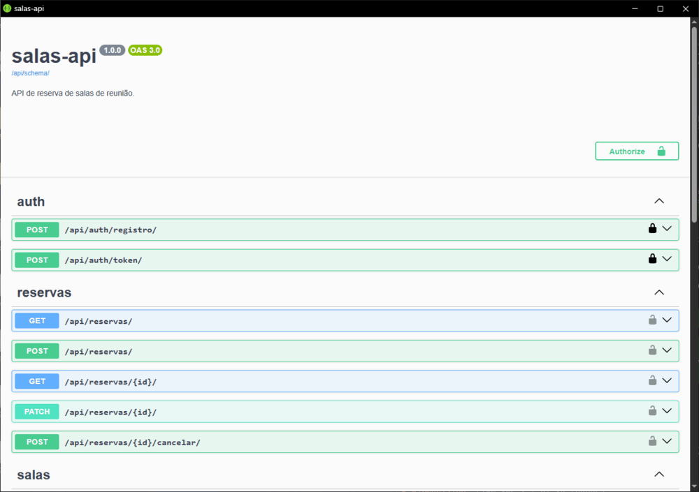
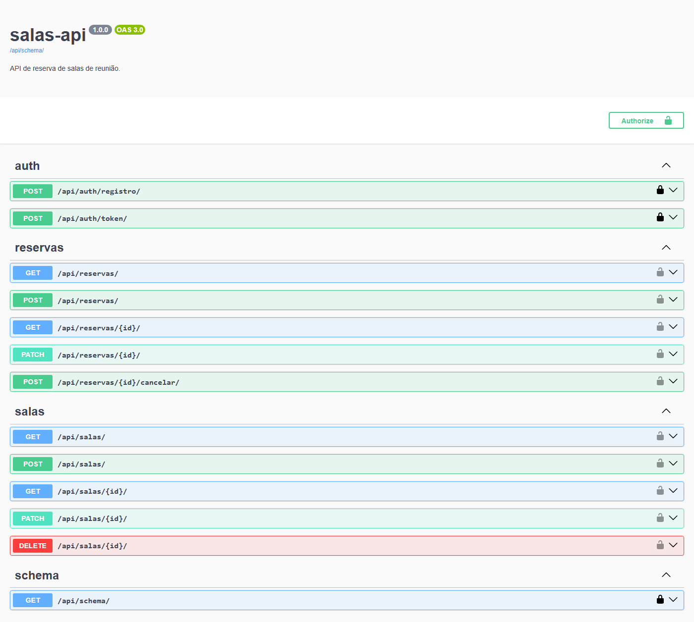

# salas-api

API de reserva de salas de reunião em Django REST Framework, em que duas reservas confirmadas não podem se sobrepor na mesma sala, e quem garante isso é o PostgreSQL.

[](https://github.com/9Arthur/salas-api/actions/workflows/ci.yml)

**Em produção:** <https://salas-api-9arthur.fly.dev/api/docs/> (Swagger). Usuário de demonstração: `demo` / `demo1234` (usuário comum).
A máquina fica parada quando ociosa: a primeira requisição depois de uma pausa leva cerca de 5 segundos.

124 testes, cobertura de 99% (medida no CI da `main`).





## Como rodar

Precisa de Docker e [uv](https://docs.astral.sh/uv/).

```bash
sed 's/^SECRET_KEY=$/SECRET_KEY=dev-nao-e-segredo/' .env.example > .env && docker compose up -d --wait db
uv run python manage.py migrate && uv run python manage.py seed_demo
uv run python manage.py runserver
```

A documentação fica em <http://127.0.0.1:8000/api/docs/>. Os testes rodam com `uv run pytest`.

## Decisões técnicas

- Escolhi barrar a sobreposição no banco, com uma `ExclusionConstraint` (`btree_gist`), em vez de só validar no Python, porque duas requisições simultâneas passariam pela validação em Python ao mesmo tempo; só o banco decide.
- Escolhi a `TokenAuthentication` nativa do DRF em vez de JWT, porque o token vive no banco e revogar um acesso é apagar uma linha, sem lista de bloqueio.
- Escolhi `select_related("sala", "usuario")` na listagem em vez de deixar o serializer buscar cada sala e cada usuário, porque a listagem fica em duas consultas com qualquer número de reservas; um teste conta as consultas com 1 e com 3 reservas.
- Escolhi um `/healthz/` que faz `SELECT 1` sem `try/except` em vez de responder 200 sempre, porque ele prova a aplicação de pé e o banco alcançável: com o banco fora, o health check tem de falhar, e não esconder o problema atrás de um 200.
- Escolhi ler o `Fly-Forwarded-Proto` em vez do `X-Forwarded-Proto` para saber se o pedido veio por HTTPS, porque o proxy do Fly repassa o `X-Forwarded-Proto` como o cliente mandou e sempre sobrescreve o `Fly-Forwarded-Proto`.

As demais decisões (SA-) e as lacunas da ficha decididas (L-) estão em [`docs/decisoes.md`](docs/decisoes.md).

## Estrutura

```
src/
├── config/          settings (base, dev, prod), urls e /healthz/
├── users/           usuário customizado, registro e login por token
└── reservas/        salas e reservas: models, services, permissions, filters, views
tests/               pytest-django, um arquivo por assunto
docs/decisoes.md     decisões técnicas e lacunas
Dockerfile           imagem de produção (gunicorn + whitenoise)
fly.toml             deploy no Fly.io (banco no Neon)
```

## O que ficou de fora

Fora do escopo desde o início: front-end, notificações por e-mail, reservas recorrentes e convidados.

Limitações conhecidas, deixadas de fora de propósito:

- F1: sem limite de tentativas (throttle) no login e no registro.
- F2: um e-mail vazio (`""`) não é barrado no banco: não há `CheckConstraint` no campo.
- F3: a senha crua não está marcada com `@sensitive_variables`.
- F4: o `RegistroSerializer` não tem `update()`.
- F5: o token não expira.
- F6: as rotas escritas à mão (`/healthz/`, `/api/docs/`, registro e login) não têm `name=`.
- F7: a `TokenAuthentication` roda no próprio login.
- F8: uma corrida entre dois registros com o mesmo username dá 500.
- F9: uma corrida entre duas salas com o mesmo nome dá 500.
- F10: o `IsAuthenticated` global não tem teste direto.
- F11: uma reserva em andamento não pode ser estendida.
- F12: o id de uma sala inativa é distinguível de um id inexistente.
- F13: uma corrida entre apagar uma sala e criar uma reserva nela dá 500.
- F14: a resposta do `cancelar` e do `PATCH` faz 2 `SELECT`s a mais (a cópia relida vem sem `JOIN`).
- F15: os filtros da listagem também valem nas rotas de detalhe.
- F16: sem Content-Security-Policy.
- F17: reverter a migração `0002` apaga a extensão `btree_gist`.
- F18: o `seed_demo` falha se alguém registrar `demo@exemplo.com` antes.
- F19: sem `CONN_MAX_AGE`.
- F20: o log de acesso mostra o IP do proxy, não o do cliente.
- F21: o painel `/admin/` só tem Grupos e Tokens: "admin" na API é papel (`is_staff`), não o painel.
- F22: a imagem do Postgres no CI e no compose (`postgres:17`) usa tag móvel, ao contrário das actions do CI (SA-62).
- F23: o schema OpenAPI não documenta as respostas 400 (o Swagger as mostra como "Undocumented").
